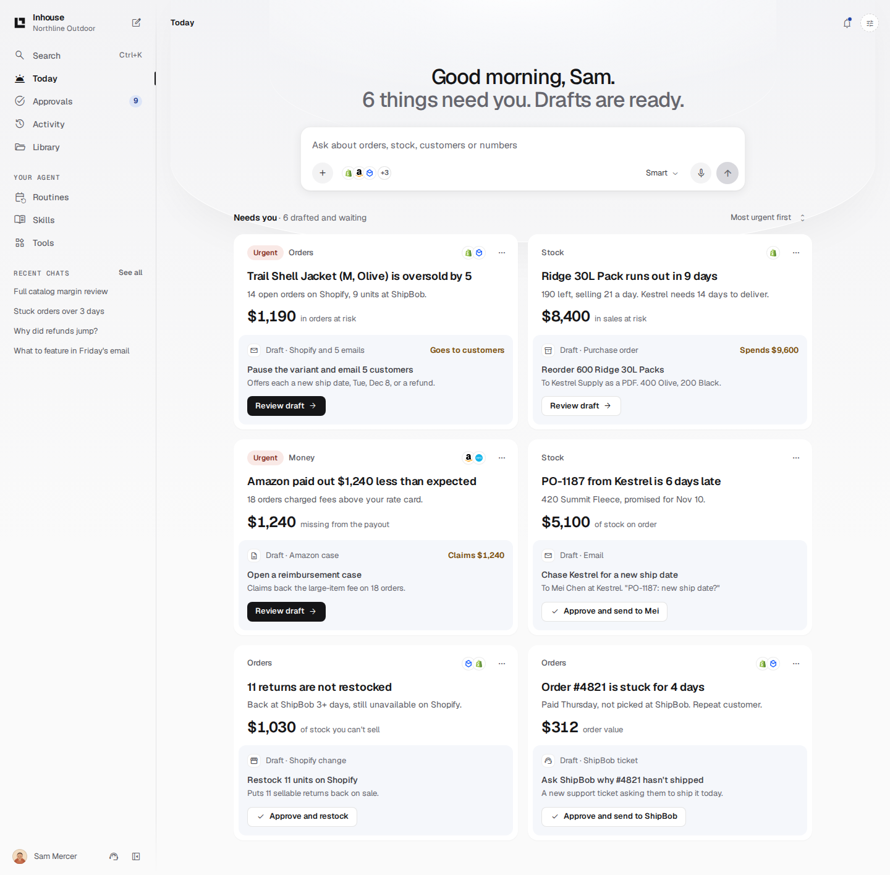
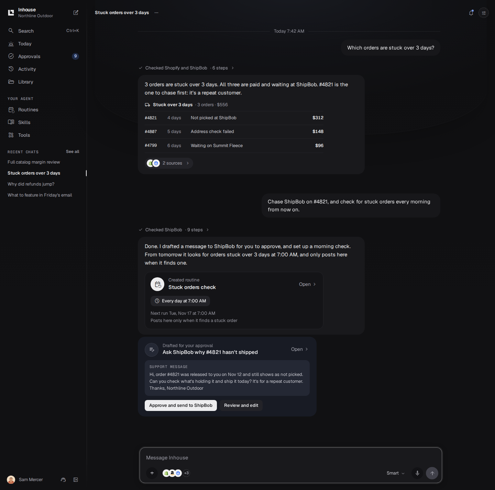
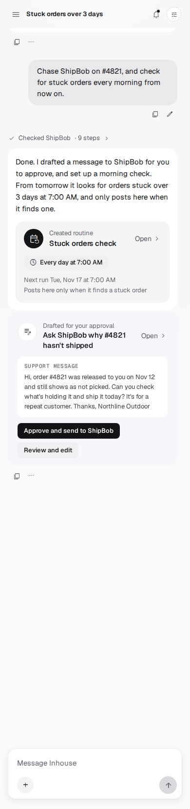

# Inhouse

Inhouse is a web app for a brand's team to work with an AI agent: Today, Library, Approvals, Routines, Activity, Tools, Skills, Usage and Settings, plus chats, at the stages Watch, Act and Run.

This is phase 1. It runs on invented sample data through a deterministic mock agent, so nothing real is connected. Every screen reads through one `AgentClient` interface, so a real agent can replace the mock later.

The code lives in [`app/`](app/). Its [README](app/README.md) covers the architecture, the mock agent and the UI regression suite.

**Live demo:** [inhouse.usefulbuild.com](https://inhouse.usefulbuild.com). It deploys from `main` on every merge.



| Desktop, dark | Phone, light |
|---|---|
|  |  |

The screenshots are the committed visual baselines, so they match what CI checks.

## How it's built

This repo is also a case study in building with AI coding agents.

- [Architecture](docs/architecture.md): the app, its one agent seam, the Worker, CI, previews and deploys
- [Decision records](docs/decisions/README.md): why each piece is the way it is
- [How this repo is built](docs/how-we-build.md): the agents, the gates and what went wrong
- [Runbook](docs/runbook.md): incidents and rollback

## Stack

- React 19 and TypeScript, built with Vite
- Tailwind v4 and shadcn/ui (Radix), light and dark themes
- Cloudflare Workers with static assets
- Playwright for end-to-end, visual and accessibility tests

## Run it

You need Node 26 (see `app/.nvmrc`) and npm.

```bash
cd app
npm ci
npm run dev
```

Then open http://localhost:5173. Add `?demo` to the URL to show the demo switcher (stage, scenario and Reset demo).

## Check it

```bash
cd app
npm run typecheck   # tsc -b
npm run lint        # oxlint plus the design token checks
npm run build
npm run test:e2e    # every Playwright project, against the production build
```

The first E2E run needs a browser: `npx playwright install chromium`. The visual baselines are Linux renders, so run the visual projects with `npm run test:visual:linux` (Docker); on macOS `npm run test:e2e` skips them. See `app/README.md`.

## Contributing

Issues are welcome. Outside pull requests aren't accepted. See [CONTRIBUTING.md](CONTRIBUTING.md).

## License

[PolyForm Strict 1.0.0](LICENSE). Commercial use isn't permitted.

## Sample data

Everything in `app/src/agent/sample-data/` is invented: the brand, the people, the orders and the numbers. There's no real customer data in this repo.
