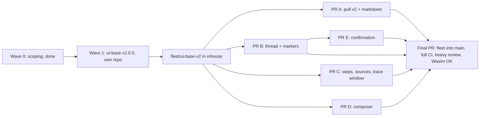

# UI base v2: shadcn chat and agent components

Tracks the ui-base v2 round Wasim asked for on 2026-11-25. Paths are relative to `app/` unless they start with `ui-base/`. Update this file in every PR of the plan: tick what landed, add the PR link, note anything moved or dropped and why.

**Status: Waves 0 to 3 merged into `fleet/ui-base-v2` on 2026-11-25: the v2 pull (#398), D composer (#399), B thread (#400), A markdown (#401), C steps (#402), A2 Mermaid (#403, added at Wasim's ask), E confirmation (#405). Final PR into `main`: full CI, High-tier review, live QA, then ship (Wasim gave overnight approval to merge and deploy once everything is green).**

## What and why

shadcn/ui shipped chat components in June 2026 (Message Scroller, Message, Bubble, Attachment, Marker, the `shimmer` and `scroll-fade` utilities) and agent components in October 2026 (Trace, Code Block, Questionnaire), plus 21 "AI Elements" patterns built from them (Chain of Thought, Tool, Sources, Confirmation, Queue, Checkpoint and more). The older Vercel `elements.ai-sdk.dev` registry is deprecated at the end of November 2026, so we take only the shadcn versions.

We adopt their **structure and behavior**, and keep **our tokens and design**:

- **Pieces we already have** (thread, answer card, composer, approvals): our layout and look on top, shadcn's structure and behavior underneath.
- **Pieces we don't have** (trace rows, time and model markers, sources list, running row): shadcn's look, re-tokened, lightly polished.

## Locked decisions

1. **No Vercel AI SDK, no new server events.** One app-side mapper turns our live `step` events and finished `Trace` into Trace rows (spec in Wave 2, PR C).
2. **Markdown: Streamdown + Code Block, no syntax highlighting.** shadcn's own Message pattern says the same. `use-highlighted-code` (shiki) is never installed.
3. **Components go in ui-base; patterns stay in the app.** ui-base v2 ships the 16 components so every app gets them. The AI Elements patterns are copy-in compositions that know our data, so they live in `src/ui/agent/` (most upstream patterns type against the AI SDK, and base-owned files get rewritten on update).
4. **ui-base keeps `@/lib/utils`.** Upstream moved to the `cn` package in September; plain `cn` drops our scale merges. We rewrite the import when vendoring and add a lint rule that bans `from "cn"` in `components/ui/`. A later minor release can move to `createCn` with a parity test.
5. **Trace window: keep the shell, rebuild the body.** Shell (Plain/Technical switch, 6 stats, replay) stays. Body becomes nested Trace rows; Technical detail renders in a Code Block. Plain view never mounts a Code Block (the no-persona guard).
6. **Inline steps become Chain of Thought; the live line becomes a running Trace row with shimmer; the sources row becomes shadcn's Sources** ("Used 3 sources", each row with the tool's logo, what it read and how long). During a run the rows build up as steps arrive (a small `view.ts` change keeps the list, not only the latest label).
7. **Time markers, not times on steps.** A centred Marker ("Today 0:25") before the first message, after a gap of an hour or more, and at a day change. The time leaves the steps meta. The person's message time is already stored (`chat_messages.at_ms`, `StoredMessageSchema`); we add an optional `at` to the client's user message and set it from the frame time on `turn.queued`. No migration, no route change. A "Switched to <model>" marker comes from the agent messages' `model`, client-side.
8. **Checkpoint Restore is later** (it needs a server-side rewind; pair it with M1 of the one-agent plan). Markers now.
9. **reveal.ts stays, slimmed.** The agent sends whole `part` events, not token deltas, so without pacing answers pop in. Keep the word-boundary pacing, `useRevealed`, `markRevealed` and `onBusy`; drop the per-word fade spans and the markdown-cutting code Streamdown now covers.
10. **`@shadcn/react` is the only new runtime library besides Streamdown.** Exact pin (it's 0.x), with an entry in `docs/adopted-libraries.md`.

## Settled decisions (Wasim, 2026-11-25)

| # | Question | Decision |
|---|---|---|
| D1 | Scroll feel | Pin the new question near the top and let the answer grow under it (`scrollAnchor` on the person's turn, `defaultScrollPosition="last-anchor"`). `motion.spec.ts` gets rewritten for it |
| D2 | Trace window's time bars | A slim duration bar on each row in the Technical view, so parallel steps stay visible; Plain view shows rows only |
| D3 | Skills page markdown (`look="page"`) | Moves to Streamdown too: one renderer, `Markdown.tsx` goes |

## How it lands



- **Small PRs** (A to E) run only the light checks (typecheck, lint, unit, property) and merge into `fleet/ui-base-v2` with merge commits.
- **Heavy work runs once** on the final `fleet/ui-base-v2` into `main` PR: builds, bundle guards, E2E, a11y, visual baselines (through `baselines.yml`), test-build, then the review by `REVIEW.md` tier (Opus 5.5 high + Gemini Neon; Fable 5.2 + Neon + Wasim if a sensitive path is touched), `ship.yml` and Wasim's OK on the exact head SHA.
- **ui-base v2 lands first in its own repo** (its CI installs into fresh Vite and Next apps and proves app-owned files survive). Inhouse can try a branch before the tag with `npx shadcn@4.23.0 add Useful-Build/ui-base/update#<ref> -y --overwrite` (bundles only).

## Agents

| Wave | Agents (parallel) | Work |
|---|---|---|
| 0 | Gemini Hydrogen, Sonnet, Opus medium | Scoping (done) |
| 1 | Opus medium | ui-base v2.0.0 |
| 2 | Sonnet (A), Opus medium (B), Gemini Hydrogen (C), Sonnet (D) | One worktree each off `fleet/ui-base-v2`; the file split below keeps them apart |
| 3 | Sonnet (E) | Waits for B (both touch the turn layout) |
| Final | Opus 5.5 high, Gemini Neon | Review of the whole fleet PR |

Opus (this thread) coordinates, checks each PR against this file and merges into the fleet branch.

## Wave 1: ui-base v2.0.0 (`Useful-Build/ui-base`)

- [x] New `registry/ui/`: collapsible, hover-card, scroll-area, tabs, progress, spinner, item, input-group, message, bubble, marker, attachment, message-scroller, trace, code-block, questionnaire. Vendored from the `radix-nova` style (`/r/styles/radix-nova/<name>.json`), each file noting the upstream version it came from.
- [x] Restyle: lucide to `Icon`; role tokens only; `@/lib/utils`; global focus outline. Bubble's oklch tint fails `check-tokens`: its default variant matches today's user bubble look with existing tokens. `text-[0.625rem]`, `rounded-[4px]` and `rounded-[calc(var(--radius)-5px)]` map to `text-2xs`, `rounded-xs`. Spinner wraps `Icon` in a `span role="status"`.
- [x] `icon-names.ts`: add `content_copy`, `arrow_downward`, `progress_activity`.
- [x] `ui-base.css`: `data-open`, `data-closed`, `data-checked`, `data-disabled`, `data-active`, `data-horizontal`, `data-vertical` variants; `shimmer*` and `scroll-fade*` utilities copied from `shadcn/tailwind.css` (MIT, attributed). No `@import "shadcn/tailwind.css"`.
- [x] `registry.json`: an item each; all of them in `base`, `base-next`, `update`, `update-next`; `@shadcn/react` (exact pin) in those bundles. No `use-highlighted-code`.
- [x] Lint rule: no `from "cn"` in `components/ui/`.
- [x] Kitchen-sink fixtures for the new components in light and dark; regression suite green.
- [x] CHANGELOG v2.0.0: new components, 3 new icon names (breaking for the type check), new CSS, `@shadcn/react`, `cn` not adopted yet, `icon.tsx` is app-owned and needs the 3 names mapped.

## Wave 2 and 3: inhouse PRs into `fleet/ui-base-v2`

### PR A: pull v2 + markdown (Sonnet)
Files: `components/ui/*` (from the update), `components/ui/icon.tsx`, `screens/chat/markdown/` (new), `Markdown.tsx`, `md-syntax.ts`, `reveal.ts`, `screens/Skills.tsx` (if D3), `docs/adopted-libraries.md`, `DESIGN.md` and `DESIGN_SYSTEM.md` update command (use `Useful-Build/ui-base/update`; the `ui-base/update` shorthand has no `registries` entry).
- [x] Map the 3 new icons in `icon.tsx`, then `npx shadcn@4.23.0 add Useful-Build/ui-base/update#v2.0.0 -y --overwrite`; typecheck, lint.
- [x] Streamdown behind the existing `Markdown({ text, linkHosts, look })` seam so `markdown-links*.test.ts`, `parts.test.ts` and `skills.test.ts` keep working. The `a` override reuses `linkHosts` (exact hosts, no mailto, images only when listed). Fix `adopted-libraries.md`, which says mailto and `['*']`.
- [x] Keep: `#` renders as h2, single newline is a break (`remark-breaks`), `>100` stays text, numbered regions ("Code block N", "Table N"), Copy buttons, `data-md-code`, `data-md-table`. Fenced code goes to Code Block, no highlighting.
- [x] Write the guards the doc names: `streamed.property.test.ts`, `markdown.differential.test.ts` (wide table rows will differ from GFM: pin the decision).
- [x] Slim `reveal.ts` (decision 9); delete `md-syntax.ts` and the `--animate-word-in` CSS.
- [x] Streamdown entry in `adopted-libraries.md` moves to "In use" (`@shadcn/react` landed with the pull).

### PR A2: Mermaid diagrams (Sonnet, asked for by Wasim 2026-11-25)
Files: `screens/chat/markdown/` (`diagram.tsx`, `diagram-engine.ts`, `diagram-svg.ts`, `diagram-theme.ts`, edits to `components.tsx`, `plugins.ts`, `policy.ts`, `renderer.tsx`), `build-support/markdown-entry.test.ts`, `src/agent/mock-script.ts` (one sample answer), `e2e/conversation.spec.ts`, `docs/adopted-libraries.md`, `FEATURE_MAP.md`.
- [x] `mermaid` 12.3.0 (exact pin) installed; `@streamdown/mermaid` is not (see the note).
- [x] A ` ```mermaid ` fence in chat and on the Skills page is a diagram; no other surface changes.
- [x] Mermaid loads only when a diagram is drawn: one `import('mermaid')` in `diagram-engine.ts`, not in the entry chunk and not in the renderer chunk; `markdown-entry.test.ts` and `diagram-engine.test.ts` pin it.
- [x] Strict config: `securityLevel: 'strict'`, `htmlLabels: false`, no links, images or embedded pages in the figure; the CSP is not loosened.
- [x] Our tokens as `themeVariables` at each draw; redraws on a light or dark change; a bordered card that scrolls sideways and stays inside the column.
- [x] While the fence is open (`live`) a quiet "Drawing diagram…" line, never an error; a diagram that fails after it closes shows "Couldn't draw this diagram." over its source and logs with `console.error`.
- [x] `svg[role=img]` with an `aria-label`; Show source and Copy; no animation of its own (the global reduced-motion rule covers Mermaid's animated edges).
- [x] Unit tests (fence detection, states, config, theme, engine), a fast-check property (any text renders while live), one E2E test on a new invented sample answer ("Show me a diagram of how a refund moves through the team").
- [x] Docs: `adopted-libraries.md` (new Mermaid entry, Streamdown entry updated), `FEATURE_MAP.md`.
- Note (as built):
  - **No `@streamdown/mermaid`.** Its `index.js` is `import a from 'mermaid'` at the top, so loading the plugin loads Mermaid; and its diagram block brings Streamdown's own Tailwind classes, which this build never generates. Our `pre` override already replaces Streamdown's code block, so the plugin would have sat unused. The brief's "wrap it so the import happens on first use" is met by the engine's dynamic import of `mermaid` itself, with the plugin's config (strict, no error figure) kept.
  - **Version:** `mermaid` 12.3.0 (3 weeks old), root-level `htmlLabels` (the per-diagram setting is deprecated).
  - **Not run here:** no browser. Whether Mermaid draws under the real CSP, its chunk size, and the look in both themes are for CI's E2E and the PR's preview. Estimated weight: about 3.3 MB of unminified chunks in the package, loaded per diagram type; expect a few hundred KB gzip for the core plus flowchart.
  - **Token colours:** `themeVariables` need hex or rgb (Mermaid's colour maths cannot read oklch or `color-mix`); a token in another format goes through a 1-pixel canvas to 8-digit hex.
  - **Follow-ups:** add `mermaid` to the `registered` Dependabot group (`.github/dependabot.yml`); the agent's prompt does not yet tell it when a diagram helps (prompt edits need the eval suite, so not here).

### PR B: thread + markers (Opus medium)
Files: `screens/Chats.tsx`, `screens/chat/view.ts`, `shared/contract/chat.ts`, `src/agent/sample-data/mock-chat.ts`, `src/ui/agent/` (new: thread parts).
- [x] Message Scroller replaces the scroll code (`Chats.tsx` 30-31, 157-158, 222-279, 435-436, 571-582); keep `aria-label="Conversation"`, `aria-busy`, a hold when a fold opens at the live edge (`onToggleLong`), and the `overflow-auto` class the E2E helpers find (or update the helpers).
- [x] D1 decides `scrollAnchor` on the person's turn and `defaultScrollPosition="last-anchor"`.
- [x] User turn on `Message align="end"` + `Bubble`, our look; `LongText` on Bubble's collapsible with the same `data-long-text` and 8-line clamp. Answer card stays one card per answer (decision 0002).
- [x] Time markers and "Switched to <model>" markers (decision 7); optional `at` on the user `ChatMessage`; `view.ts` sets it from the frame's `at` on `turn.queued`. Settle the `workRow` time (`Parts.tsx:182-186`) so nothing shows twice. (Removing the time from `[data-steps-meta]` moved to PR C, which owns `Steps.tsx`.)
- [x] Stopped note and Retry on `Marker`. `QueuedChip` stays ours (shadcn's Queue is the agent's todo list, not queued messages).

### PR C: steps, sources, trace window (Gemini Hydrogen)
Files: `screens/chat/step-data.ts`, `screens/chat/Steps.tsx`, `screens/chat/LiveSteps.tsx`, `overlays/TraceWindow.tsx`, `ui/agent/` (`trace.tsx`), `screens/chat/view.ts` live-steps list (coordinate with B: C owns `liveSteps` + `LiveSteps`, B owns `at`).
- [x] Mapper in `step-data.ts`: `mapLiveStepsToTraceRows` and `mapTraceToTraceRows`. Status: latest live step `running`, earlier ones done; `turn.finished failed` marks the last `error`; stopped or cancelled clears it. Trace kinds: `fail` is `error`, `approval` is `pending`, nesting from `depth`. Icon is the tool's logo via `toolKeyOf`, else a kind icon. Existing helpers stay unchanged.
- [x] Chain of Thought for the steps line (`[data-steps-meta]` drops time, keeps mode and duration); running rows with `shimmer` for live steps (`LiveSteps.tsx`, `view.ts` `liveSteps`); Sources pattern for `sourcesOf()` rows (no links: they're tool records).
- [x] Trace window body on nested `Trace` rows (decision 5); D2 decides the slim duration bars in Technical view, Plain view shows prose only (`CodeBlock`, `detail`, `io`, model ids, and tokens never mounted in Plain view). Replay maps time to `pending` / `running` / done.
- [x] Keep `data-steps`, `data-steps-meta`, `data-sources`, `data-thinking`, `aria-expanded`, Details opens the trace window, phone tap sizes, reduced motion. `trace-row` moves from `aria-pressed` to `aria-expanded`: updated `no-persona.spec.ts` with it. Specs that match `expand_more` or time on `[data-steps-meta]` updated (`conversation.spec.ts`, `sample-data.spec.ts`, `memory.spec.ts`, `ship/agent-seam.spec.ts`).

### PR D: composer (Sonnet)
Files: `components/Composer.tsx`, `ui/chrome.tsx` (`AttachmentChip`), `screens/chat/FileChip.tsx`.
- [x] Shell on `InputGroup` + `InputGroupTextarea`, our card look (`rounded-2xl`, `shadow-float`); rewrite the `has-[>textarea:focus]` focus selector against InputGroup's `data-slot`.
- [x] Attach and Send/Stop as `InputGroupButton`s; chips in a `block-start` addon as `Attachment size="sm"`, rejected files `state="error"` with `role=alert`.
- [x] Stays ours: tools chip, model and thinking menu, dictate, reply-to quote, editing bar, the hidden file input and `takeFiles`, drag state, Enter and IME rules. Keep `data-composer`, `data-composer-send` and every aria-label.
- [x] `AttachmentChip` replaced by `Attachment`.
- Note (as built): `Composer.tsx` is an `InputGroup` with `data-composer` on the group; the textarea is `InputGroupTextarea`; the notes, chips and button row are `InputGroupAddon`s (`block-start`, `block-end`) that pass `onClick={undefined}` because the addon's stock click handler focuses the group's first `<input>`, which here is the hidden file input. A disabled Send would fade the whole group through InputGroup's `has-disabled:opacity-50`: the composer sets `has-disabled:opacity-100`. Attach, Queue, Send and Stop are `InputGroupButton`s (`size="icon-sm"`, `variant={null}` for Attach and Queue); the tools chip, model button and Dictate stay plain buttons. `AttachmentChip` keeps its export (Chats.tsx uses it for sent files) and its props, and is now a wrapper over `Attachment size="sm"`: state `error` for a rejected file, `processing` while a download runs, else `done`. The composer holds files until Send, so it has no `uploading` chip; upload progress stays in the thread. The Remove, Dismiss and Download buttons stay `IconButton`s (28px with a 44px phone tap area) inside `AttachmentActions`, not `AttachmentAction`.

### PR E: confirmation (Sonnet, after B)
Files: `screens/chat/Parts.tsx` (`ApprovalCard`).
- [x] `ApprovalCard` on the Confirmation pattern (`Item` + `Button`s). Keep `bg-draft-sheet`, the draft body, sensitive gating (1-tap Approve vs Review), the Undo row, `data-approval`. Sets up M2's Allow once / Always allow.
- [x] Approvals page and review window stay hand-built.
- Dropped: the Queue part of PR E. shadcn's Queue is the agent's to-do list, not queued messages, and our `QueuedChip` stays (see the PR B notes). Nothing to build.
- Note (as built): the composition is `ui/agent/confirmation.tsx` (`Confirmation`, `ConfirmationButtons`, `ConfirmationResult`); `ApprovalCard` in `Parts.tsx` keeps the logic (not-found line, sensitive gating, Approve, Review, Undo) and passes buttons in as children. shadcn's Confirmation is only a documented pattern (an outline `Item` with Deny and Approve), so ours is `Item` with the sheet look: `ItemMedia` is the icon tile, `ItemContent` holds the kicker (`ItemDescription`, `order-first`) over the title (`ItemTitle`, unclamped), `ItemActions` holds the "Open" link, and each button row is an `ItemFooter` with `ItemActions`. The `Item` is a column (`flex-col`) so the draft text box and the button row sit under the head. No Deny button: "Review and edit" is the other answer. No E2E selector changed (`data-approval`, button names and the `.bg-card` check hold).

### Every PR
- [x] `FEATURE_MAP.md` lines for the surface (chat 143-160, composer 123-127, trace window 489-493, gaps 11-12) updated in the same PR.
- [x] Light checks green: `npm run typecheck && npm run lint && npm run test:unit` through `light-lock.sh`.
- [x] Commit trailer `Verified: <what ran>`.
- [x] This file updated.

## Before and after (estimates from scoping)

| Area | Before | After |
|---|---|---|
| Markdown | `Markdown.tsx` 310 + `md-syntax.ts` 4, own parser | ~60 on Streamdown + Code Block |
| Reveal | `reveal.ts` 155 + per-word fade CSS | ~70, pacing only |
| Thread | `Chats.tsx` 616 with ~70 lines of hand scroll logic | ~500; scroll on Message Scroller |
| Composer | 468 | ~400 on Input Group + Attachment (built: 472, the shell changed but the menus and rules are ours) |
| Chips | `AttachmentChip` ~45 | Attachment (built: ~35, a wrapper over the base) |
| Steps and sources | `Steps.tsx` 119 + `step-data.ts` 99 | ~105 + ~150 (the mapper moves logic out of the JSX) |
| Trace window | 266 | ~220 |
| **Net** | | **about 600 fewer lines of hand-built UI** |

The bigger gain is behavior we stop owning:
- **Scrolling:** reading signals (wheel, touch, keys), anchoring the new question, opening a chat where you left off, no jump when older messages load, jump to any message, fast long threads.
- **Markdown:** half-written markdown handled while streaming.
- **One row shape** for every step, source and trace line.
- **Ready starts for what's next:** Task, Plan, Subagent, Queue, Questionnaire and Context for the one-agent plan, instead of blank files.

## Risks

1. `@shadcn/react` is 0.x and upstream moves fast: exact pins, upstream version noted in each vendored file.
2. A later plain `npx shadcn add` from upstream brings `cn` imports that skip our merge config: the lint rule catches it.
3. The update overwrites inhouse's locally edited `DESIGN_SYSTEM.md` (lines 3, 104-108, 121): move those edits into ui-base first, or re-apply after.
4. Many E2E selectors and visual baselines change at once: all of them land in the final fleet PR's one CI run, with the spec edits in the PR that caused them.
5. Radix `CollapsibleContent` unmounts when closed (Base UI's `keepMounted` doesn't exist): check specs that expect `[hidden]` content.

## Notes from the build

- **Wave 1 deviations (ui-base#4):** Button gains `icon-xs` (24px). Bubble's `default` is a soft neutral fill (`bg-fill-hover`), `tinted` uses `bg-brand-tint`; upstream's primary-filled look is gone. Trace text steps up a shade for axe contrast. Body text in Message, Bubble, Item and Tabs is our `text-base` (14px). Code Block logs a failed copy instead of swallowing it.
- **The pull (PR into the fleet):** the update bundle also adds `lucide-react` and the two `@fontsource-variable/geist*` packages to `package.json`. Inhouse uses Material Symbols and its own fonts, so they were dropped again, and `@shadcn/react` re-pinned exactly. Follow-up for ui-base: an `update` bundle shouldn't add deps an app replaced. `DESIGN_SYSTEM.md` took the base's text (it already said `Useful-Build/ui-base/update`, fixing our stale `ui-base/update` shorthand).
- **JS budget (Wasim, 2026-11-25):** PR D measured 242.3 KB against Today's 241 KB first-load budget (Chats shares the entry chunk). Raised to 252 KB for this round; the final fleet PR tightens it to the measured size plus 1 KB. B, C and D together measured 255.1 KB, so Wasim approved 257 KB (covers E's ~1 KB) the same day. Streamdown (PR A) loads on demand, outside the entry chunk.
- **For PR B:** inhouse's user bubble (`bg-bubble`, `rounded-3xl`, `px-4.5 py-3`, `text-md`) differs from Bubble's default: pass our classes through a wrapper in `src/ui/agent/`. Tabs now ship from the base and look like the segmented control.
- **PR B (thread + markers):** the thread's parts live in `src/ui/agent/thread.tsx` (`ThreadScroller`, `ThreadViewport`, `ThreadLog`, `ThreadRow`, `UserTurn`, `LongText`, `ThreadMarker`, `NoteMarker`, `JumpToLatest`) and `hold-view.ts`; the markers are a pure `screens/chat/markers.ts` with a fast-check test. Message Scroller now owns where a chat opens (its last question), pinning a new question near the top, following the live edge, the reader's scroll signals and prepend; we still own Jump to latest's look (it renders only while there is more below, from `useMessageScrollerScrollable`), the hold when a fold opens (a synthetic wheel event, `holdView`: @shadcn/react 0.3.1 has no public "let go" call), the thinking card (inside the log, so it sits above the spacer) and the markers. Deviations: only the newest question is a `scrollAnchor` (a row redrawn under a new key, a sent question taking its stored id, would otherwise send the view back to the oldest unhandled anchor); rows paint in full (`content-visibility: visible` in `index.css`), since `auto` clips the steps line, hover fills and focus outlines that hang past a row; the sent question and the sample chats' questions get `at` too (`store.ts` at the send, `derive.ts` from the chat's time), so the marker shows from the first frame and in the demo. Known gap: a Retry that hides more rows than it adds doesn't pin the new question.
- **PR A (markdown):** Streamdown 2.8.1 + `remark-breaks` 4.0.0 behind `Markdown({ text, linkHosts, look, live })` in `src/screens/chat/markdown/`. `Markdown.tsx` (310 lines) and `md-syntax.ts` are gone; `reveal.ts` is 77 lines (was 155).
  - **Bundle budget (not in the plan):** Streamdown and its parsers measure about 170 KB gzip (a one-off esbuild bundle of the package), and Chats is in the entry chunk, so the renderer is its own chunk (`markdown/renderer.tsx`) behind a lazy `markdown/index.tsx`: idle prefetch, plain lines until it loads, `build-support/markdown-entry.test.ts` pins that nothing imports it up front. Tests import `renderer.tsx` directly.
  - **New seam prop:** `live` (the text is still being written or revealed) turns on Streamdown's incomplete-markdown handling; `Parts.tsx` passes `streaming || !done`, and drops `fade`.
  - **Link rules:** the old rules, enforced twice (`harden` with `https://<host>/` prefixes, then the components via `policy.ts`). `adopted-libraries.md` was wrong about mailto and `['*']` in chat (`['*']` is only for a page). Issue #767 is closed and 2.8.1 passes `#/` through, so the `#user-content-/` workaround is not needed. A `HTTPS://` scheme with capitals is lowercased by one small rehype step, since the sanitizer would drop it.
  - **Kept by plugin:** raw HTML shows as text (a `<order-id>` placeholder stays visible), and a table row wider than the header widens it instead of losing cells (GFM would drop them), so the "wide rows" difference the plan expected did not happen.
  - **Intended differences** (pinned with reasons in `markdown.differential.test.ts`): CommonMark emphasis and setext headings, strikethrough, task boxes, indented code, reference links, entities and escapes, tables without edge pipes (and a text line right under a table becomes a row), blockquotes hold paragraphs, loose lists are one list, a wrapped list line is a break, and a page shows no images. The Skills page uses the same renderer (D3).
  - **Look:** fenced code is the base Code Block (size sm) through `src/ui/code-snippet.tsx`, with the old rounded fill and an always-visible Copy button. It gains the base's edge fade while it scrolls sideways. The per-word fade (`--animate-word-in`, `ih-word-in`) is gone; the reveal only paces.
- **PR C (`feat/uibv2-c-steps`):** Moved `Thinking` out of `Chats.tsx` into `screens/chat/LiveSteps.tsx` (58 lines) fed by `view.liveSteps`; `Steps.tsx` 135, `step-data.ts` 251, `TraceWindow.tsx` 363. Shared `Trace`, `CodeBlock`, `Badge`, and row marks live in `src/ui/agent/trace.tsx` (76 lines). Removed `at` from `[data-steps-meta]` and updated `memory.spec.ts` to read saved message `at` via `fx` while awaiting PR B's centered time `Marker`s; updated `conversation.spec.ts`, `sample-data.spec.ts`, `ship/agent-seam.spec.ts`, and `no-persona.spec.ts`.
