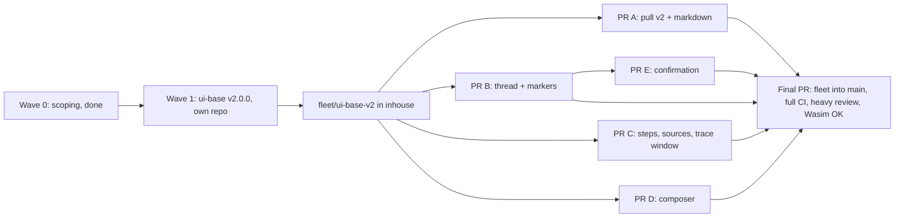

# UI base v2: shadcn chat and agent components

Tracks the ui-base v2 round Wasim asked for on 2026-11-25. Paths are relative to `app/` unless they start with `ui-base/`. Update this file in every PR of the plan: tick what landed, add the PR link, note anything moved or dropped and why.

**Status: plan approved by Wasim 2026-11-25, D1 to D3 settled as recommended. Wave 0 (scoping) done. Wave 1 (ui-base v2.0.0) in progress.**

## What and why

shadcn/ui shipped chat components in June 2026 (Message Scroller, Message, Bubble, Attachment, Marker, the `shimmer` and `scroll-fade` utilities) and agent components in October 2026 (Trace, Code Block, Questionnaire), plus 21 "AI Elements" patterns built from them (Chain of Thought, Tool, Sources, Confirmation, Queue, Checkpoint and more). The older Vercel `elements.ai-sdk.dev` registry is deprecated at the end of November 2026, so we take only the shadcn versions.

We adopt their **structure and behavior**, and keep **our tokens and design**:

- **Pieces we already have** (thread, answer card, composer, approvals): our layout and look on top, shadcn's structure and behavior underneath.
- **Pieces we don't have** (trace rows, time and model markers, sources list, running row): shadcn's look, re-tokened, lightly polished.

## Locked decisions

1. **No Vercel AI SDK, no new server events.** One app-side mapper turns our live `step` events and finished `Trace` into Trace rows (spec in Wave 2, PR C).
2. **Markdown: Streamdown + Code Block, no syntax highlighting.** shadcn's own Message pattern says the same. `use-highlighted-code` (shiki) is never installed.
3. **Components go in ui-base; patterns stay in the app.** ui-base v2 ships the 16 components so every app gets them. The AI Elements patterns are copy-in compositions that know our data, so they live in `src/ui/agent/` (most upstream patterns type against the AI SDK, and base-owned files get rewritten on update).
4. **ui-base keeps `@/lib/utils`.** Upstream moved to the `cn` package in September; plain `cn` drops our scale merges. We rewrite the import when vendoring and add a lint rule that bans `from "cn"` in `components/ui/`. A later minor release can move to `createCn` with a parity test.
5. **Trace window: keep the shell, rebuild the body.** Shell (Plain/Technical switch, 6 stats, replay) stays. Body becomes nested Trace rows; Technical detail renders in a Code Block. Plain view never mounts a Code Block (the no-persona guard).
6. **Inline steps become Chain of Thought; the live line becomes a running Trace row with shimmer; the sources row becomes shadcn's Sources** ("Used 3 sources", each row with the tool's logo, what it read and how long). During a run the rows build up as steps arrive (a small `view.ts` change keeps the list, not only the latest label).
7. **Time markers, not times on steps.** A centred Marker ("Today 0:25") before the first message, after a gap of an hour or more, and at a day change. The time leaves the steps meta. The person's message time is already stored (`chat_messages.at_ms`, `StoredMessageSchema`); we add an optional `at` to the client's user message and set it from the frame time on `turn.queued`. No migration, no route change. A "Switched to <model>" marker comes from the agent messages' `model`, client-side.
8. **Checkpoint Restore is later** (it needs a server-side rewind; pair it with M1 of the one-agent plan). Markers now.
9. **reveal.ts stays, slimmed.** The agent sends whole `part` events, not token deltas, so without pacing answers pop in. Keep the word-boundary pacing, `useRevealed`, `markRevealed` and `onBusy`; drop the per-word fade spans and the markdown-cutting code Streamdown now covers.
10. **`@shadcn/react` is the only new runtime library besides Streamdown.** Exact pin (it's 0.x), with an entry in `docs/adopted-libraries.md`.

## Settled decisions (Wasim, 2026-11-25)

| # | Question | Decision |
|---|---|---|
| D1 | Scroll feel | Pin the new question near the top and let the answer grow under it (`scrollAnchor` on the person's turn, `defaultScrollPosition="last-anchor"`). `motion.spec.ts` gets rewritten for it |
| D2 | Trace window's time bars | A slim duration bar on each row in the Technical view, so parallel steps stay visible; Plain view shows rows only |
| D3 | Skills page markdown (`look="page"`) | Moves to Streamdown too: one renderer, `Markdown.tsx` goes |

## How it lands

- **Small PRs** (A to E) run only the light checks (typecheck, lint, unit, property) and merge into `fleet/ui-base-v2` with merge commits.
- **Heavy work runs once** on the final `fleet/ui-base-v2` into `main` PR: builds, bundle guards, E2E, a11y, visual baselines (through `baselines.yml`), test-build, then the review by `REVIEW.md` tier (Opus 5.5 high + Gemini Neon; Fable 5.2 + Neon + Wasim if a sensitive path is touched), `ship.yml` and Wasim's OK on the exact head SHA.
- **ui-base v2 lands first in its own repo** (its CI installs into fresh Vite and Next apps and proves app-owned files survive). Inhouse can try a branch before the tag with `npx shadcn@4.23.0 add Useful-Build/ui-base/update#<ref> -y --overwrite` (bundles only).

## Agents

| Wave | Agents (parallel) | Work |
|---|---|---|
| 0 | Gemini Hydrogen, Sonnet, Opus medium | Scoping (done) |
| 1 | Opus medium | ui-base v2.0.0 |
| 2 | Sonnet (A), Opus medium (B), Gemini Hydrogen (C), Sonnet (D) | One worktree each off `fleet/ui-base-v2`; the file split below keeps them apart |
| 3 | Sonnet (E) | Waits for B (both touch the turn layout) |
| Final | Opus 5.5 high, Gemini Neon | Review of the whole fleet PR |

Opus (this thread) coordinates, checks each PR against this file and merges into the fleet branch.

## Wave 1: ui-base v2.0.0 (`Useful-Build/ui-base`)

- [ ] New `registry/ui/`: collapsible, hover-card, scroll-area, tabs, progress, spinner, item, input-group, message, bubble, marker, attachment, message-scroller, trace, code-block, questionnaire. Vendored from the `radix-nova` style (`/r/styles/radix-nova/<name>.json`), each file noting the upstream version it came from.
- [ ] Restyle: lucide to `Icon`; role tokens only; `@/lib/utils`; global focus outline. Bubble's oklch tint fails `check-tokens`: its default variant matches today's user bubble look with existing tokens. `text-[0.625rem]`, `rounded-[4px]` and `rounded-[calc(var(--radius)-5px)]` map to `text-2xs`, `rounded-xs`. Spinner wraps `Icon` in a `span role="status"`.
- [ ] `icon-names.ts`: add `content_copy`, `arrow_downward`, `progress_activity`.
- [ ] `ui-base.css`: `data-open`, `data-closed`, `data-checked`, `data-disabled`, `data-active`, `data-horizontal`, `data-vertical` variants; `shimmer*` and `scroll-fade*` utilities copied from `shadcn/tailwind.css` (MIT, attributed). No `@import "shadcn/tailwind.css"`.
- [ ] `registry.json`: an item each; all of them in `base`, `base-next`, `update`, `update-next`; `@shadcn/react` (exact pin) in those bundles. No `use-highlighted-code`.
- [ ] Lint rule: no `from "cn"` in `components/ui/`.
- [ ] Kitchen-sink fixtures for the new components in light and dark; regression suite green.
- [ ] CHANGELOG v2.0.0: new components, 3 new icon names (breaking for the type check), new CSS, `@shadcn/react`, `cn` not adopted yet, `icon.tsx` is app-owned and needs the 3 names mapped.

## Wave 2 and 3: inhouse PRs into `fleet/ui-base-v2`

### PR A: pull v2 + markdown (Sonnet)
Files: `components/ui/*` (from the update), `components/ui/icon.tsx`, `screens/chat/markdown/` (new), `Markdown.tsx`, `md-syntax.ts`, `reveal.ts`, `screens/Skills.tsx` (if D3), `docs/adopted-libraries.md`, `DESIGN.md` and `DESIGN_SYSTEM.md` update command (use `Useful-Build/ui-base/update`; the `ui-base/update` shorthand has no `registries` entry).
- [ ] Map the 3 new icons in `icon.tsx`, then `npx shadcn@4.23.0 add Useful-Build/ui-base/update#v2.0.0 -y --overwrite`; typecheck, lint.
- [ ] Streamdown behind the existing `Markdown({ text, linkHosts, look })` seam so `markdown-links*.test.ts`, `parts.test.ts` and `skills.test.ts` keep working. The `a` override reuses `linkHosts` (exact hosts, no mailto, images only when listed). Fix `adopted-libraries.md`, which says mailto and `['*']`.
- [ ] Keep: `#` renders as h2, single newline is a break (`remark-breaks`), `>100` stays text, numbered regions ("Code block N", "Table N"), Copy buttons, `data-md-code`, `data-md-table`. Fenced code goes to Code Block, no highlighting.
- [ ] Write the guards the doc names: `streamed.property.test.ts`, `markdown.differential.test.ts` (wide table rows will differ from GFM: pin the decision).
- [ ] Slim `reveal.ts` (decision 9); delete `md-syntax.ts` and the `--animate-word-in` CSS.
- [ ] `@shadcn/react` and Streamdown entries in `adopted-libraries.md`.

### PR B: thread + markers (Opus medium)
Files: `screens/Chats.tsx`, `screens/chat/view.ts`, `shared/contract/chat.ts`, `src/agent/sample-data/mock-chat.ts`, `src/ui/agent/` (new: thread parts).
- [ ] Message Scroller replaces the scroll code (`Chats.tsx` 30-31, 157-158, 222-279, 435-436, 571-582); keep `aria-label="Conversation"`, `aria-busy`, a hold when a fold opens at the live edge (`onToggleLong`), and the `overflow-auto` class the E2E helpers find (or update the helpers).
- [ ] D1 decides `scrollAnchor` on the person's turn and `defaultScrollPosition="last-anchor"`.
- [ ] User turn on `Message align="end"` + `Bubble`, our look; `LongText` on Bubble's collapsible with the same `data-long-text` and 8-line clamp. Answer card stays one card per answer (decision 0002).
- [ ] Time markers and "Switched to <model>" markers (decision 7); optional `at` on the user `ChatMessage`; `view.ts` sets it from the frame's `at` on `turn.queued`. Remove the time from `[data-steps-meta]` and settle the `workRow` time (`Parts.tsx:182-186`) so nothing shows twice.
- [ ] Stopped note and Retry on `Marker`. `QueuedChip` stays ours (shadcn's Queue is the agent's todo list, not queued messages).

### PR C: steps, sources, trace window (Gemini Hydrogen)
Files: `screens/chat/step-data.ts`, `screens/chat/Steps.tsx`, `overlays/TraceWindow.tsx`, the `Thinking` component (move it out of `Chats.tsx` into `screens/chat/` first, so B and C don't collide), `screens/chat/view.ts` live-steps list (coordinate with B: C owns the `liveSteps` field, B owns `at`).
- [ ] Mapper in `step-data.ts`: `mapLiveStepsToTraceRows` and `mapTraceToTraceRows`. Status: latest live step `running`, earlier ones done; `turn.finished failed` marks the last `error`; stopped or cancelled clears it. Trace kinds: `fail` is `error`, `approval` is `pending`, nesting from `depth`. Icon is the tool's logo via `toolKeyOf`, else a kind icon. Existing helpers stay unchanged.
- [ ] Chain of Thought for the steps line; running row with `shimmer` for the live line; Sources pattern for `sourcesOf()` rows (no links: they're tool records).
- [ ] Trace window body on nested rows (decision 5); D2 decides the time bars. Replay maps time to `pending` / `running` / done.
- [ ] Keep `data-steps`, `data-steps-meta`, `data-sources`, `data-thinking`, `aria-expanded`, Details opens the trace window, phone tap sizes, reduced motion. `trace-row` moves from `aria-pressed` to `aria-expanded`: update `no-persona.spec.ts` with it. Specs that match the `expand_more` ligature text change with the chevron.

### PR D: composer (Sonnet)
Files: `components/Composer.tsx`, `ui/chrome.tsx` (`AttachmentChip`), `screens/chat/FileChip.tsx`.
- [ ] Shell on `InputGroup` + `InputGroupTextarea`, our card look (`rounded-2xl`, `shadow-float`); rewrite the `has-[>textarea:focus]` focus selector against InputGroup's `data-slot`.
- [ ] Attach and Send/Stop as `InputGroupButton`s; chips in a `block-start` addon as `Attachment size="sm"`, rejected files `state="error"` with `role=alert`.
- [ ] Stays ours: tools chip, model and thinking menu, dictate, reply-to quote, editing bar, the hidden file input and `takeFiles`, drag state, Enter and IME rules. Keep `data-composer`, `data-composer-send` and every aria-label.
- [ ] `AttachmentChip` replaced by `Attachment`.

### PR E: confirmation (Sonnet, after B)
Files: `screens/chat/Parts.tsx` (`ApprovalCard`).
- [ ] `ApprovalCard` on the Confirmation pattern (`Item` + `Button`s). Keep `bg-draft-sheet`, the draft body, sensitive gating (1-tap Approve vs Review), the Undo row, `data-approval`. Sets up M2's Allow once / Always allow.
- [ ] Approvals page and review window stay hand-built.

### Every PR
- [ ] `FEATURE_MAP.md` lines for the surface (chat 143-160, composer 123-127, trace window 489-493, gaps 11-12) updated in the same PR.
- [ ] Light checks green: `npm run typecheck && npm run lint && npm run test:unit` through `light-lock.sh`.
- [ ] Commit trailer `Verified: <what ran>`.
- [ ] This file updated.

## Before and after (estimates from scoping)

| Area | Before | After |
|---|---|---|
| Markdown | `Markdown.tsx` 310 + `md-syntax.ts` 4, own parser | ~60 on Streamdown + Code Block |
| Reveal | `reveal.ts` 155 + per-word fade CSS | ~70, pacing only |
| Thread | `Chats.tsx` 616 with ~70 lines of hand scroll logic | ~500; scroll on Message Scroller |
| Composer | 468 | ~400 on Input Group + Attachment |
| Chips | `AttachmentChip` ~45 | Attachment |
| Steps and sources | `Steps.tsx` 119 + `step-data.ts` 99 | ~105 + ~150 (the mapper moves logic out of the JSX) |
| Trace window | 266 | ~220 |
| **Net** | | **about 600 fewer lines of hand-built UI** |

The bigger gain is behavior we stop owning:
- **Scrolling:** reading signals (wheel, touch, keys), anchoring the new question, opening a chat where you left off, no jump when older messages load, jump to any message, fast long threads.
- **Markdown:** half-written markdown handled while streaming.
- **One row shape** for every step, source and trace line.
- **Ready starts for what's next:** Task, Plan, Subagent, Queue, Questionnaire and Context for the one-agent plan, instead of blank files.

## Risks

1. `@shadcn/react` is 0.x and upstream moves fast: exact pins, upstream version noted in each vendored file.
2. A later plain `npx shadcn add` from upstream brings `cn` imports that skip our merge config: the lint rule catches it.
3. The update overwrites inhouse's locally edited `DESIGN_SYSTEM.md` (lines 3, 104-108, 121): move those edits into ui-base first, or re-apply after.
4. Many E2E selectors and visual baselines change at once: all of them land in the final fleet PR's one CI run, with the spec edits in the PR that caused them.
5. Radix `CollapsibleContent` unmounts when closed (Base UI's `keepMounted` doesn't exist): check specs that expect `[hidden]` content.

## Notes from the build

(empty)
