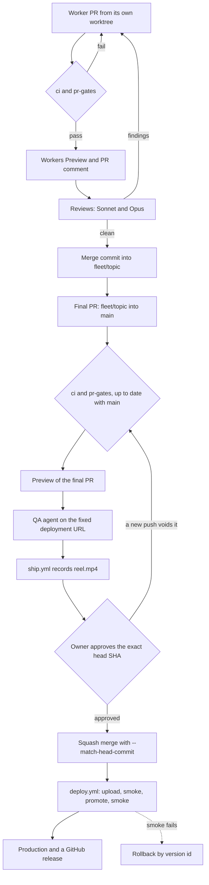

# Architecture

Inhouse is a single-page app on invented sample data, served by one Cloudflare Worker. This page covers how the app is
put together and how a change travels from a PR to production. Why each piece is the way it is lives in the
[decision records](decisions/README.md). How to run and test it is in [app/README.md](../app/README.md).

## The app

A React 19 and TypeScript single-page app, built with Vite, styled with Tailwind v4 and shadcn/ui components on Radix.
Routes are hashes (`#/today`, `#/chats/<id>`, `#/settings/<tab>`), so every deep link is the same `index.html` and the
server never needs to know the routes.

```
app/src/agent/    AgentClient interface, the mock agent, its clock and the invented sample data
app/src/state/    selectors (derive.ts) and the UI store (zustand)
app/src/screens/  one file per page
app/src/shell/    sidebar, top bar, toasts, demo switcher
app/src/ui/       the app's components on top of the base's (app/src/components/ui/)
app/worker/       the Worker
```

### One seam: AgentClient

Every screen reads and writes through one interface, `AgentClient` in `app/src/agent/types.ts`.
`app/src/agent/index.ts` is the one place that picks the implementation, and today it picks `MockAgent`. No screen,
store or selector reads the sample data directly.

The contract is shaped like a real agent:

- Writes are async. They apply at once, resolve when saved, and on failure take the change back, reject with a typed
  `AgentError` and send a notice.
- Reads React uses are synchronous snapshots (`getSnapshot`, `read`, `listFiles`).
- A question streams `RunEvent`s: `run.started`, `step`, `part`, `approval.requested`, `run.finished` and so on. A
  running answer takes messages (`send` with a priority), `interrupt` and `stop`.

The mock is deterministic: no randomness and no model calls. Answers come from a script in `sample-data/`, timed
against one demo clock ([0005](decisions/0005-us-formats-one-demo-clock.md)). The backend plan replaces it with a real
client behind the same seam, and the same contract suite will run on both.

### State and persistence

- **Domain state** (chats, approvals, routines, files, settings) belongs to the agent client. The mock keeps it in
  local storage, so the demo survives a reload ([0007](decisions/0007-phase-1-memory-in-local-storage.md)).
- **UI state** (the open chat, runs by chat, queued messages, drafts, toasts) is a small zustand store,
  `app/src/state/store.ts`. A chat that's left mid-answer keeps answering
  ([0009](decisions/0009-leaving-a-chat-finishes-the-answer.md)).
- **Derived views** (a tool's state, counts, the chat list) come from selectors in `app/src/state/derive.ts`, so every
  screen shows the same fact.
- Reset demo (open any build with `?demo`) clears every key and returns to the starting state.

## The Worker

One Worker, `inhouse-app` (`app/wrangler.jsonc`), with static assets. Cloudflare serves the built files before the
Worker runs, and `not_found_handling: single-page-application` answers any other path with `index.html`. Headers come
from `app/public/_headers`.

`/api/*` is the exception: it reaches the Worker first (`run_worker_first`). The first route is `/api/client-error`,
which takes error reports from the browser, rate-limits and scrubs them and logs them to Workers Logs with the release
SHA ([0020](decisions/0020-client-errors-into-workers-logs.md)). That route is being built in the hardening project.
Until it lands, the Worker answers 404 to anything that isn't an asset.

## CI and the gates

Two rulesets, kept as JSON in `.github/rulesets/`, guard `main` and `fleet/**`
([0013](decisions/0013-rulesets-as-committed-json.md)). Both require a PR and two checks, with no bypass:

- **`ci`** (`.github/workflows/ci.yml`): type check, lint (oxlint plus the design token rules), the Vitest and
  fast-check property tests, a production build and every Playwright project (desktop, phone, visual, accessibility),
  in a digest-pinned Playwright image so screenshots render the same every run. The suite is split across two shards,
  and a final job named `ci` passes only if both did.
- **`pr-gates`**: every commit carries a `Verified:` trailer saying how it was checked, and a change to an existing
  check (a spec, a baseline, a property test, a lint script, a workflow) is flagged so the PR has to explain it.

The visual suite compares 188 Linux baselines in light and dark, at desktop and phone size. A change meant to
show commits new baselines, so the image diff is part of the PR.

## Previews

When `ci` passes on a same-repo PR, `preview.yml` deploys that build as a Cloudflare Workers Preview named
`pr-<n>` ([0011](decisions/0011-workers-previews-from-trusted-workflow.md)). It runs on `workflow_run`, so its code is
always `main`'s. The build is treated as untrusted: only plain files under `dist/` pass, and the generated wrangler
config must match `main`'s field by field before the token is used. One PR comment carries a URL that follows the PR, a
deployment URL fixed to one commit and the head SHA. Previews are public and send `noindex`
([0012](decisions/0012-public-preview-urls.md)). `preview-cleanup.yml` deletes the previews of closed PRs daily.

## The ship recording

`ship.yml` is run by hand on a final PR. It reads the fixed deployment URL from the preview comment, runs the
project's ship specs (`app/e2e/ship/<topic>.spec.ts`) against it with video on and slowed down, on desktop and phone,
and stitches one `reel.mp4` with a title card per scenario carrying the SHA. The PR's code runs only in the recording
job, with read access and no secrets. The owner watches the reel and approves that exact SHA
([0016](decisions/0016-ship-recording-and-exact-sha-approval.md)).

## Deploys

As designed in the production plan, and landing in a parallel PR ([0019](decisions/0019-deploy-on-merge-with-rollback.md)):

1. A merge into `main` starts `deploy.yml`. A build job with no secrets uploads the exact build.
2. A trusted job in environment `production` uploads it as a new Worker version tagged with the SHA, smokes that
   version's URL, promotes it to 100%, then smokes the live hostname.
3. It tags a GitHub release `vYYYY.MM.DD.N`.
4. Rollback promotes an earlier version by id, in the same concurrency group as deploys. Steps are in the
   [runbook](runbook.md).

A scheduled check watches production and notifies the owner on failure
([0021](decisions/0021-monitoring-and-runbook.md)). The Cloudflare token lives only in GitHub environments that
`main`'s workflows can use ([0015](decisions/0015-one-cloudflare-token-in-environments.md)).

## From PR to production



Small changes skip the integration branch and go straight into `main` through the same checks. How the agents work
inside this flow is in [how-we-build.md](how-we-build.md).
