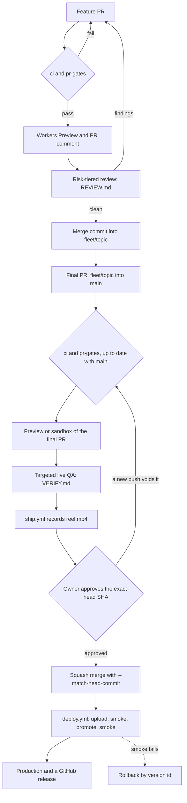

# Architecture

Inhouse is a single-page app on invented sample data, served by one Cloudflare Worker. This page covers how the app is
put together and how a change travels from a PR to production. Why each piece is the way it is lives in the
[decision records](decisions/README.md). How to run and test it is in [app/README.md](../app/README.md).

## The app

A React 19 and TypeScript single-page app, built with Vite, styled with Tailwind v4 and shadcn/ui components on Radix.
Routes are hashes (`#/today`, `#/chats/<id>`, `#/settings/<tab>`), so every deep link is the same `index.html` and the
server never needs to know the routes.

```
app/src/agent/    AgentClient interface, the mock agent, its clock and the invented sample data
app/src/state/    selectors (derive.ts) and the UI store (zustand)
app/src/screens/  one file per page
app/src/shell/    sidebar, top bar, toasts, demo switcher
app/src/ui/       the app's components on top of the base's (app/src/components/ui/)
app/worker/       the Worker
```

### One seam: AgentClient

Every screen reads and writes through one interface, `AgentClient` in `app/src/agent/types.ts`.
`app/src/agent/index.ts` is the one place that picks the implementation, and today it picks `MockAgent`. No screen,
store or selector reads the sample data directly.

The contract is shaped like a real agent:

- Writes are async. They apply at once, resolve when saved, and on failure take the change back, reject with a typed
  `AgentError` and send a notice.
- Reads React uses are synchronous snapshots (`getSnapshot`, `read`, `listFiles`).
- A question streams `RunEvent`s: `run.started`, `step`, `part`, `approval.requested`, `run.finished` and so on. A
  running answer takes messages (`send` with a priority), `interrupt` and `stop`.

The demo uses the deterministic `MockAgent`. Answers come from a script in `sample-data/`, timed against one
demo clock ([0005](decisions/0005-us-formats-one-demo-clock.md)). The product uses `HttpAgent` to talk to the Worker
through the same `AgentClient` interface. The shared contract suite runs against both clients.

### State and persistence

- **Domain state** (chats, approvals, routines, files, settings) belongs to the agent client. The mock keeps it in
  local storage, so the demo survives a reload ([0007](decisions/0007-phase-1-memory-in-local-storage.md)).
- **UI state** (the open chat, runs by chat, queued messages, drafts, toasts) is a small zustand store,
  `app/src/state/store.ts`. A chat that's left mid-answer keeps answering
  ([0009](decisions/0009-leaving-a-chat-finishes-the-answer.md)).
- **Derived views** (a tool's state, counts, the chat list) come from selectors in `app/src/state/derive.ts`, so every
  screen shows the same fact.
- In the demo build, open `?demo` to use Reset demo. It clears the demo state and restores the starting state.

## The Worker

One Worker, `inhouse-app` (`app/wrangler.jsonc`), with static assets. Cloudflare serves the built files before the
Worker runs, and `not_found_handling: single-page-application` answers any other path with `index.html`. Headers come
from `app/public/_headers`.

`/api/*` is the exception: it goes to the Worker first (`run_worker_first`). Its one route is `/api/client-error`,
which takes error reports from the browser, rate-limits and scrubs them and logs them to Workers Logs with the release
SHA ([0020](decisions/0020-client-errors-into-workers-logs.md)). Any other `/api/*` path gets a 404 with the same
security headers as the pages.

## CI and the gates

Two rulesets, kept as JSON in `.github/rulesets/`, guard `main` and `fleet/**`
([0013](decisions/0013-rulesets-as-committed-json.md)). Both require a PR and two checks, with no bypass:

- **`ci`** (`.github/workflows/ci.yml`): type check, lint (oxlint plus the design token rules), the Vitest and
  fast-check property tests, a production build and every Playwright project (desktop, phone, visual, accessibility),
  in a digest-pinned Playwright image so screenshots render the same every run. The suite is split across two shards,
  and a final job named `ci` passes only if every job that event runs did. That full suite runs on PRs into `main`
  and on each push to `fleet/**`; a PR into `fleet/**` runs only the fast checks (type check, lint, unit, the builds
  and their guards, the fresh-install migrations, the runner's tests), phase batching (Wasim, 2026-11-21).
- **`pr-gates`**: every commit carries a `Verified:` trailer saying how it was checked, and a change to an existing
  check (a spec, a baseline, a property test, a lint script, a workflow) is flagged so the PR has to explain it.

The visual suite compares 188 Linux baselines in light and dark, at desktop and phone size. A change meant to
show commits new baselines, so the image diff is part of the PR.

## Previews

When `ci` passes on a same-repo PR, `preview.yml` deploys that build as a Cloudflare Workers Preview named
`pr-<n>` ([0011](decisions/0011-workers-previews-from-trusted-workflow.md)). It runs on `workflow_run`, so its code is
always `main`'s. The build is treated as untrusted: only plain files under `dist/` pass, and the generated wrangler
config must match `main`'s field by field before the token is used. One PR comment carries a URL that follows the PR, a
deployment URL fixed to one commit and the head SHA. Previews are public and send `noindex`
([0012](decisions/0012-public-preview-urls.md)). `preview-cleanup.yml` deletes the previews of closed PRs daily.

## The ship recording

`ship.yml` is run by hand on a final PR. It reads the fixed deployment URL from the preview comment, runs the
project's ship specs (`app/e2e/ship/<topic>.spec.ts`) against it with video on and slowed down, on desktop and phone,
and stitches one `reel.mp4` with a title card per scenario carrying the SHA. The PR's code runs only in the recording
job, with read access and no secrets. The owner watches the reel and approves that exact SHA
([0016](decisions/0016-ship-recording-and-exact-sha-approval.md)).

## Deploys

Every merge into `main` deploys ([0019](decisions/0019-deploy-on-merge-with-rollback.md)):

1. A merge into `main` starts `deploy.yml`. A build job with no secrets uploads the exact build.
2. A trusted job in environment `production` uploads it as a new Worker version tagged with the SHA, smokes that
   version's URL, promotes it to 100%, then smokes the live hostname.
3. It tags a GitHub release `vYYYY.MM.DD.N`.
4. Rollback promotes an earlier version by id, in the same concurrency group as deploys. Steps are in the
   [runbook](runbook.md).

An hourly check (`monitor.yml`) watches production and opens an issue assigned to the owner on failure
([0021](decisions/0021-monitoring-and-runbook.md)). The Cloudflare token lives only in GitHub environments that
`main`'s workflows can use ([0015](decisions/0015-one-cloudflare-token-in-environments.md)).

## From PR to production



Small changes skip the integration branch and go straight into `main` through the same checks. How the agents work
inside this flow is in [how-we-build.md](how-we-build.md).

## Product Worker, connector hub, and Watch backend (P2-P5)

The product build (`app/server/`, entry `server/index.ts`) replaces `MockAgent` with `HttpAgent` (`app/src/agent/http/`) and runs behind a Cloudflare Worker with D1, R2, Durable Objects, a container runner (`app/runner/`), and an isolated connector hub (`app/hub/`).

- **Request pipeline:** every `/api/*` request passes through Cloudflare Access JWT authentication (`server/auth/`), the `Origin` check, route dispatch (`server/routes.ts`), its row in `server/access-matrix.ts` (`checkAccess`), and the handler. Every answer carries the security headers (`shared/security-headers.ts`, synced from `app/public/_headers`). Number new routes with plain integers (`/* N */`) so `e2e/api/kit.ts` parses them.
- **Configs and builds:** `app/wrangler.product.jsonc` is a secret-free template (filled by the private ops repo at release). `app/wrangler.test.jsonc` is the local/sandbox test build (`npm run build:product-test`, never deployed); `scripts/check-product-config.mjs` exits `0` for a deployable config, `1` for refused configs (CI requires `1` on `wrangler.test.jsonc`), and `2` on usage/crash. `app/wrangler.eval.jsonc` (`npm run build:product-eval`) compiles the eval trace (`@eval-trace`) with real models through the gateway (no scripted model) and deploys only to the sandbox from `main`.
- **Compile-time seams:** import the test issuer only as `@test-issuer` (resolves to `issuer-off.ts` outside `product-test`/`product-eval`), eval trace only as `@eval-trace` (`off.ts` outside `product-eval`), and the test-only RPC methods (BrandAgent's `testRunAlarm`, `testStopAfterBatch`, `testSeedCursor` and `testSetTimings`, and Runner's `testKillRunner`; add no others) only as `@test-controls` (`test-controls-off.ts` outside `product-test`). `scripts/check-product-build.mjs` proves their modules and canaries are absent from the deployable bundle.
- **Migrations and storage registry:** `app/server/migrations/` is forward-only (never rename or drop a column in the release that stops using it). Numbering reserves 100-wide blocks per phase: P2 `0001`-`0099`, P3 `0100`-`0199`, P4 `0200`-`0299`, P5 `0300`-`0399`, P6 `0400`-`0499` (P6a reserves `0470`-`0479`), P7 `0500`-`0599`, P8 `0600`-`0699`. Register every D1 table, Durable Object store, and R2 prefix in `app/ops/tables/`.
- **Connector hub (`app/hub/`):** standalone package (`app/wrangler.hub.jsonc` template, `app/wrangler.hub.test.jsonc` test config) with no public route (`check-hub-config.mjs` rejects public routes and secrets in `vars`; `check-hub-build.mjs` scans bundles). Connectors live in `app/hub/connectors/<tool>/route.ts` and register in `app/hub/connectors/index.ts`. In the test build, the product Worker and hub run together under one `wrangler dev` joined by service bindings (`HUB` / `ReadGateway`, `HUB_CONNECT` / `ConnectGateway`, `HUB_DELIVERY` / `DeliveryGateway`, `HUB_WRITE` / `WriteGateway`, the last bound only by the outbox dispatcher and refusing every write outside the test build in Stage 1), backed by recorded Shopify fixtures (`app/test/upstreams/shopify/`, no npm imports allowed because CI installs only `app/hub/node_modules`) plus fake OAuth/MCP/Slack upstreams. The write-scoped Shopify app keeps its token in its own `ShopifyWriteSignIn` Durable Object (`SHOPIFY_WRITE_SIGNIN`, migration `v2`). Includes OAuth connect (`app/hub/oauth/`), Slack web delivery (`app/hub/connectors/slack/`), and MCP / code-mode (`app/hub/connectors/mcp/`, `app/hub/codemode/`).
- **Watch routes, tables, and routines (P4):** routes 52-56 Routines, 57-58 Today, 59 Activity, 60-61 bell notices, 62-66 Library (downloads send `Content-Disposition: attachment`, `X-Content-Type-Options: nosniff`, `Content-Security-Policy: sandbox`), 67 test-build alarm-now control (404 elsewhere), and 86 routine run history. Tables: `routines`, `routine_slots`, `routine_alerts`, `today_items`, `today_aside`, `activity_lines`, `notices`, `notice_reads`, `library_uploads`, `library_marks`, plus R2 prefix `library/` (migrations `0200`-`0240`). Routines execute as the shared `m_system` service member (`server/routines/render.ts`) and read brand memory only, never personal memory.
- **Connectors, Slack, and prompt v3 (P5):** routes 68-69 OAuth connect start and callback, 70-72 Tools list/pause/disconnect, 73-75 Slack notice channels, and 76 test-build test-fakes hook (404 elsewhere). Tables: `connector_accounts`, `notify_channels`, `notify_sends` (migrations `0300`-`0311`). `BrandAgent` builds the per-turn system prompt with the v3 builder, sent as version 4 since the links rule (`app/server/prompt/connected.ts`) and falls back to `SYSTEM_PROMPT_V2` when accounts cannot be read.
- **Sandbox deploys:** container-backed features (chats, routines, evals) cannot run Bash locally, so per-PR test-build deploys (`inhouse-sbx-pr<N>`, guarded by `scripts/sandbox/names.mjs`) run in the separate sandbox Cloudflare account via `inhouse-ops` and are exercised with `E2E_TEST_BUILD_REMOTE=1`. Brand releases run exclusively from the private ops repo.
